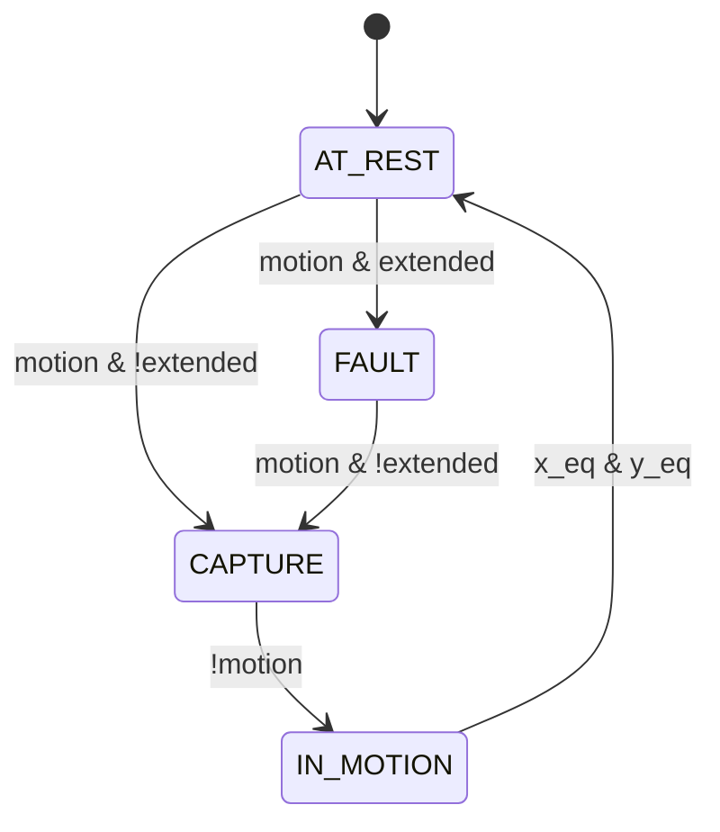
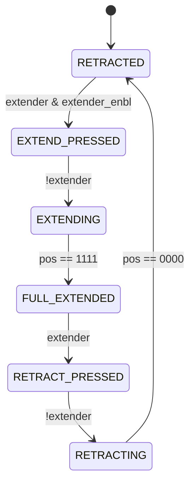
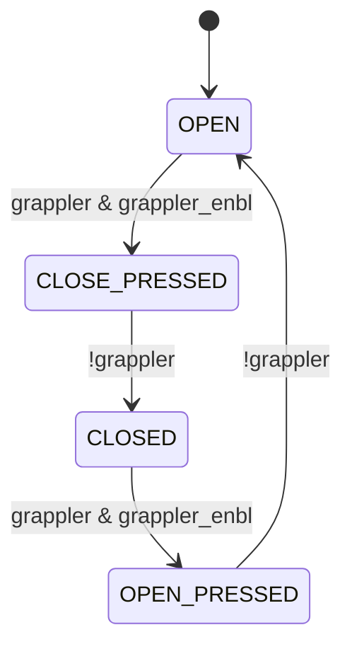

# FPGA Robotic Arm Controller (Verilog)

A Robotic Arm Controller (RAC) implemented in Verilog on an Intel MAX 10 FPGA
(`10M08SAE144C8G`, LogicalStep board). The arm moves in two dimensions, with an
extender and a grappler. Three cooperating finite state machines coordinate the
system and enforce safety interlocks between subsystems.

Built for the University of Waterloo course ECE 124 (*Digital Circuits and
Systems*), Lab 4.

## Features

- **X/Y positioning**: target coordinates (0–F) are read from slide switches and
  latched into holding registers when MOTION is pressed. When MOTION is released,
  both axes move toward the target. Each axis stops on its own when it arrives.
  Switch changes are ignored while the arm is moving.
- **Extender**: a 4-bit bidirectional shift register that extends
  `0000 → 1000 → 1100 → 1110 → 1111` and retracts in reverse.
- **Grappler**: opens and closes on each button press. It is enabled only while
  the extender is fully extended.
- **Safety interlock**: requesting X/Y motion while the extender is out blocks
  all motion and latches a *System Fault*. The fault clears only after the
  extender is fully retracted and MOTION is pressed again.
- **I/O handling**: push-buttons go through a 2-stage synchronizer to prevent
  metastability. A clock-enable generator runs all logic from a single 50 MHz
  clock domain. Position is shown on a time-multiplexed dual 7-segment display.

## Architecture

```
            ┌──────────────┐  extender_enbl  ┌──────────────┐ grappler_enbl ┌──────────────┐
 MOTION ───►│ SM  (Mealy)  │────────────────►│ SM1 (Moore)  │──────────────►│ SM2 (Moore)  │◄── GRAPPLER
            │ X/Y motion   │◄────────────────│ Extender     │               │ Grappler     │
            └──┬───────▲───┘    extended     └──┬────────▲──┘               └──────┬───────┘
     capture / │       │ eq/gt/lt     dir/enable│        │ position               │
     count_en  ▼       │                        ▼        │                        ▼
   REG_4bit ×2 → U/D Counter ×2 → Compx4 ×2   Bidir_shift_reg ──► leds[5:2]    leds[1]
                      │
                      └──► SevenSegment ×2 → segment7_mux → dual 7-seg display
```

### State machines

Each FSM follows a three-section structure: a **register** section (sequential,
clock-enabled, synchronous reset), a **transition** section (combinational) and
a **decoder** section (combinational). Every FSM has separate states for
detecting a button *press* and its *release*, so one press/hold/release
triggers exactly one action.

**SM: X/Y Motion (Mealy).** The counter enable and direction outputs depend on
the live comparator results, so each axis stops in the same clock-enable cycle
in which it reaches its target.



**SM1: Extender (Moore)**



**SM2: Grappler (Moore)**



## I/O map

| Signal             | Pin(s)      | Description                                   |
|--------------------|-------------|-----------------------------------------------|
| Reset              | `pb_n[3]`   | Resets all registers and state machines       |
| Motion             | `pb_n[2]`   | Capture target and move (press, hold, release)|
| Extender           | `pb_n[1]`   | Extend / retract toggle                       |
| Grappler           | `pb_n[0]`   | Open / close toggle                           |
| X target           | `sw[7:4]`   | Target X coordinate (hex)                     |
| Y target           | `sw[3:0]`   | Target Y coordinate (hex)                     |
| System Fault       | `leds[0]`   | Motion requested while extender out (latched) |
| Grappler status    | `leds[1]`   | 1 = closed, 0 = open                          |
| Extender position  | `leds[5:2]` | Shift register value                          |
| Extender_OUT       | `leds[6]`   | Extender not fully retracted                  |
| Arm moving         | `leds[7]`   | X or Y counter enabled                        |
| Position display   | 7-segment   | Digit 1 = X, Digit 2 = Y                      |

## Repository layout

```
rtl/
  LogicalStep_Lab4_top.v   top level: wires all blocks together
  SM.v                     X/Y motion FSM (Mealy)
  SM1.v                    Extender FSM (Moore)
  SM2.v                    Grappler FSM (Moore)
  Bidir_shift_reg.v        4-bit bidirectional shift register (extender)
  U_D_Bin_Counter4bit.v    4-bit saturating up/down counter (X/Y position)
  REG_4bit.v               4-bit target capture register
  Compx1.v, Compx4.v       1-bit and cascaded 4-bit magnitude comparators
  SevenSegment.v           hex → 7-segment decoder
  segment7_mux.v           dual-digit display multiplexer
  Synch_Inverter2.v        push-button synchronizer / inverter
  clocken_generator.v      clock-enable generator
sim/
  tb_LogicalStep_Lab4.v    self-checking testbench
  GLOBAL.v                 GLOBAL buffer model for non-Quartus simulators
quartus/
  LogicalStep_Lab4.tcl     device and pin assignments
```

## Build (Quartus Prime)

1. Create a new project named `LogicalStep_Lab4` with top level `LogicalStep_Lab4_top`.
2. Add every file in `rtl/`. Do **not** add the files in `sim/`.
3. Run `quartus/LogicalStep_Lab4.tcl` (*Tools → Tcl Scripts*) to set the device and pins.
4. Compile and program the `.sof` file onto the board.

## Simulate

Define `SIM_FLAG` so the clock-enable runs at simulation speed, either by
uncommenting `` `define SIM_FLAG `` at the top of `LogicalStep_Lab4_top.v` or
by passing it on the command line. For example, with Icarus Verilog:

```bash
iverilog -g2012 -DSIM_FLAG -o rac.vvp sim/tb_LogicalStep_Lab4.v sim/GLOBAL.v rtl/*.v
vvp rac.vvp          # prints PASS/FAIL for each check
gtkwave rac.vcd      # optional: view waveforms
```

The testbench covers:
- reset
- two-axis moves in both directions
- target switches being ignored while the arm moves
- a full extend and retract cycle
- grappler open/close
- the grappler being disabled while the extender is retracted
- the System Fault interlock latching and clearing

## Credits

The course provided the starter infrastructure: the clock-enable generator, the
synchronizer, the display modules and the Quartus pin script. The three
state machines, the top-level integration and the testbench were written for
this project.
